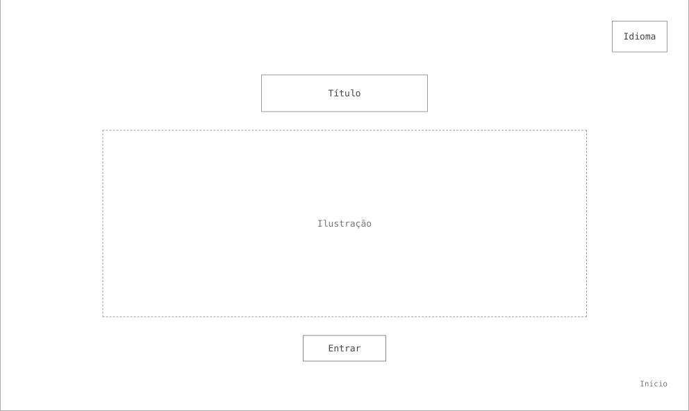
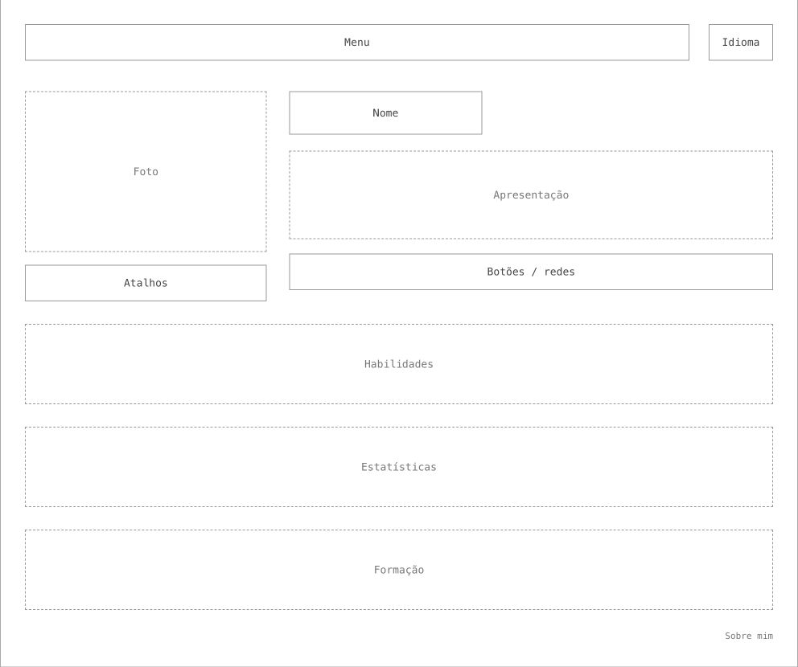
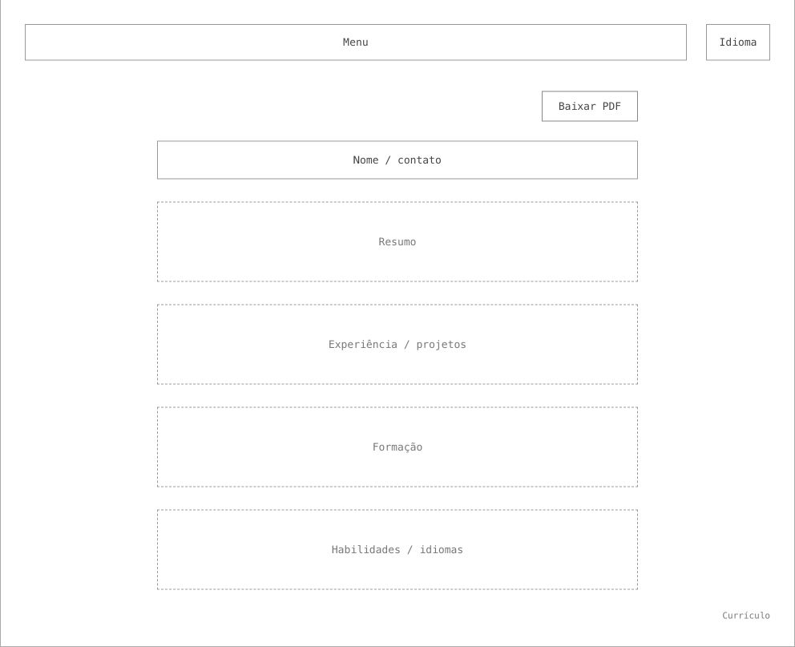
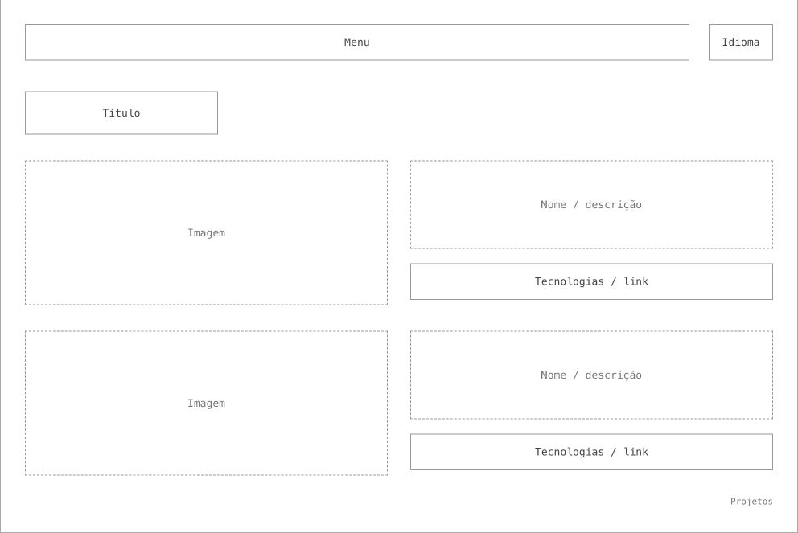
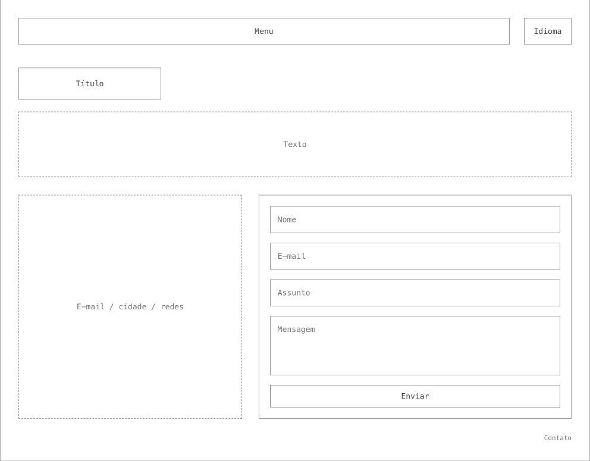

# Meu Portfolio

Bem-vindo ao código-fonte do meu site pessoal!

Sou Lucas Otávio Costa Mafia, estudante de Engenharia de Software na PUC Minas. Este portfólio apresenta minha trajetória, conhecimentos, projetos e formas de contato.

O site está organizado nas seguintes seções:

- **Início** — Página de boas-vindas com um quarto 3D interativo e uma transição para a apresentação pessoal.
- **Sobre mim** — Apresentação em português e inglês, habilidades, formação e estatísticas de atividade.
- **Projetos** — Projetos acadêmicos e profissionais, com imagens, descrições, tecnologias, datas e links para os repositórios.
- **Currículo** — Resumo profissional, experiências, formação e habilidades, com download do PDF em português ou inglês.
- **Contato** — Links de contato e formulário para envio de mensagens pelo EmailJS.

---

## Tecnologias

O projeto foi desenvolvido com:

- **React** — Construção da interface com componentes.
- **JavaScript** — Lógica da aplicação e das interações.
- **CSS** — Estilização, responsividade e animações.
- **Vite** — Servidor de desenvolvimento e geração do build de produção.

As seguintes bibliotecas são utilizadas em funcionalidades específicas:

- **React DOM** — Renderização da aplicação no navegador.
- **React Router DOM** — Navegação entre as páginas.
- **Three.js** — Renderização do quarto 3D da página inicial.
- **React Three Fiber** — Integração entre React e Three.js.
- **React Three Drei** — Utilitários disponíveis para a cena 3D.
- **i18next e react-i18next** — Traduções em português e inglês.
- **i18next Browser Language Detector** — Detecção e persistência da preferência de idioma.
- **EmailJS Browser** — Envio das mensagens do formulário de contato.

O desenvolvimento também utiliza **ESLint**, seus plugins para React Hooks e React Refresh, e o plugin oficial de React para Vite. A lista completa das dependências e versões está no [package.json](package.json); as versões instaladas estão no [package-lock.json](package-lock.json).

A interface utiliza a fonte **Space Grotesk** e ícones do **Font Awesome Free** e **Devicon**. O globo de habilidades usa Canvas 2D com projeção espacial, e o mapa de contribuições utiliza SVG com projeção 3D.

---

## Estrutura de diretórios

O projeto está organizado da seguinte forma:

```text
meu-portfolio/
├── api/
│   ├── _github.js
│   ├── _wakatime.js
│   ├── github.js
│   └── wakatime.js
├── docs/
│   ├── prototipos/
│   │   ├── 01-inicio.png
│   │   ├── 02-sobre-mim.png
│   │   ├── 03-curriculo.png
│   │   ├── 04-projetos.png
│   │   └── 05-contato.png
│   └── emailjs.md
├── public/
│   ├── curriculos/
│   │   ├── Lucas_Otavio_Costa_Mafia_Curriculo_PT.pdf
│   │   └── Lucas_Otavio_Costa_Mafia_Resume_EN.pdf
│   └── github-contributions.json
├── src/
│   ├── assets/
│   │   └── images/
│   │       ├── projetos/
│   │       │   ├── casa-limpa.png
│   │       │   └── monitoramento-queimadas.png
│   │       └── lucas-mafia.png
│   ├── components/
│   │   ├── 3d/
│   │   │   ├── ContributionSkyline.jsx
│   │   │   ├── drawSkyline.js
│   │   │   ├── Quarto3D.jsx
│   │   │   ├── SkillsGlobe.css
│   │   │   └── SkillsGlobe.jsx
│   │   ├── LanguageSwitcher/
│   │   │   ├── LanguageSwitcher.css
│   │   │   └── LanguageSwitcher.jsx
│   │   └── SiteHeader/
│   │       └── SiteHeader.jsx
│   ├── config/
│   │   ├── emailjsConfig.js
│   │   ├── i18nConfig.js
│   │   └── wakatimeConfig.js
│   ├── data/
│   │   ├── contact.js
│   │   ├── curriculo.js
│   │   ├── projetos.js
│   │   ├── skills.js
│   │   └── wakatimeDemo.js
│   ├── i18n/
│   │   ├── locales/
│   │   │   ├── en/
│   │   │   │   └── translation.json
│   │   │   └── pt-BR/
│   │   │       └── translation.json
│   │   └── index.js
│   ├── pages/
│   │   ├── contato/
│   │   │   ├── Contato.css
│   │   │   └── Contato.jsx
│   │   ├── curriculo/
│   │   │   ├── Curriculo.css
│   │   │   └── Curriculo.jsx
│   │   ├── home/
│   │   │   ├── Home.css
│   │   │   └── home.jsx
│   │   ├── projetos/
│   │   │   ├── ProjectPreview.jsx
│   │   │   ├── Projetos.css
│   │   │   └── Projetos.jsx
│   │   └── sobre/
│   │       ├── Education/
│   │       │   ├── Education.css
│   │       │   └── Education.jsx
│   │       ├── GitHubStats/
│   │       │   ├── GitHubStats.css
│   │       │   ├── GitHubStats.jsx
│   │       │   └── WakaTimeStats.jsx
│   │       ├── Skills/
│   │       │   ├── Skills.css
│   │       │   └── Skills.jsx
│   │       ├── Sobre.css
│   │       └── Sobre.jsx
│   ├── services/
│   │   ├── contactService.js
│   │   ├── githubService.js
│   │   └── wakatimeService.js
│   ├── App.jsx
│   ├── index.css
│   └── main.jsx
├── .env.example
├── .gitignore
├── eslint.config.js
├── index.html
├── package-lock.json
├── package.json
├── README.md
├── vercel.json
└── vite.config.js
```


## Protótipos

Os wireframes abaixo representam a organização das páginas em baixa fidelidade.

### Início



### Sobre mim



### Currículo



### Projetos



### Contato



## Referências

- [Materiais da disciplina — João Paulo Aramuni](https://github.com/joaopauloaramuni/desenvolvimento-e-integracao-de-aplicacoes-web).
- [SkillsGlobe](https://github.com/joaopauloaramuni/desenvolvimento-e-integracao-de-aplicacoes-web/tree/main/PROJETOS/React/SkillsGlobe) — Referência para o globo de habilidades.
- [Internacionalizacao_i18n](https://github.com/joaopauloaramuni/desenvolvimento-e-integracao-de-aplicacoes-web/tree/main/PROJETOS/React/Internacionalizacao_i18n) — Referência para a configuração de idiomas.
- [WakaTimeAPI](https://github.com/joaopauloaramuni/desenvolvimento-e-integracao-de-aplicacoes-web/tree/main/PROJETOS/React/WakaTimeAPI) — Referência para a integração de atividade.
- [Contribution Skyline](https://21st.dev/@kedhareswer?preview=%2F%40kedhareswer%2Fcomponents%2Fcontribution-skyline) — Referência visual para as contribuições em 3D.
- [Font Awesome Free](https://fontawesome.com/license/free) e [Devicon](https://devicon.dev/) — Ícones utilizados no site.

## Autor

**Lucas Otávio Costa Mafia** — estudante de Engenharia de Software na PUC Minas.

[GitHub](https://github.com/lucasomafia) · [Instagram](https://www.instagram.com/lucasomafia_/) · [E-mail](mailto:lucasomafia@gmail.com)
